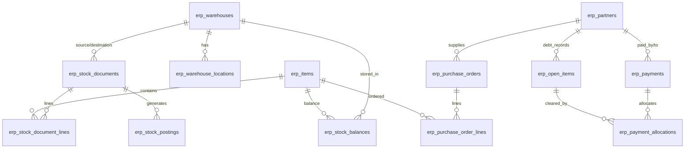

# BÁO CÁO CHI TIẾT HIỆN TRẠNG CHƯA SỬA & RÀ SOÁT LỖI 6 PHÂN HỆ CỐT LÕI (SIGNAGE ERP)
> **Phạm vi kiểm thử:** Xuyên suốt Giao diện (UI/Modal) → API Route Handlers → Cơ sở dữ liệu (PostgreSQL Schema & Constraints)  
> **Mã tài liệu:** `AUDIT-UNFIXED-6MODULES-2026-10-10`  
> **Thời điểm lập báo cáo:** 10/10/2026  
> **Các phân hệ rà soát:**
> 1. Vật tư & Quy cách — gồm định mức BOM (`/vat-tu`, `/vat-tu?tab=bom`, `ItemModal`, `BomTab`)
> 2. Quản trị kho — tồn kho, vị trí, kiểm kê (`/kho`, `stocks`, `warehouses`, `counts`, `remnants`)
> 3. Phiếu nhập – xuất – chuyển kho (`/kho/nhap-xuat`, `CreateStockDocModal`, `StockDocPrintModal`)
> 4. Khách hàng & Công nợ (`/khach-hang`, `/tai-chinh`, `DebtPaymentModal`)
> 5. Nhà cung cấp & Công nợ (`/nha-cung-cap`, `DebtPaymentModal`)
> 6. Mua hàng — đơn PO, nhận hàng (`/mua-hang`, `/mua-hang/tao-moi`, `CreateInboundReceiptModal`)
>
> **Mục đích:** Ghi nhận độc lập, chi tiết toàn bộ các khiếm khuyết, rủi ro kỹ thuật, sai lệch hợp đồng dữ liệu UI-API-DB, lỗ hổng phân quyền (RBAC) và các điểm biên **CHƯA ĐƯỢC SỬA** hoặc **CẦN TIẾP TỤC KHẮC PHỤC** trước khi tiến hành can thiệp mã nguồn.

---

## MỤC LỤC
1. [Tổng quan ma trận rà soát 6 phân hệ (Giao diện → API → Database)](#1-tổng-quan-ma-trận-rà-soát-6-phân-hệ)
2. [Chi tiết rà soát Phân hệ 1: Vật tư & Quy cách — Định mức BOM](#2-phân-hệ-1-vật-tư--quy-cách--định-mức-bom)
3. [Chi tiết rà soát Phân hệ 2: Quản trị kho — Tồn kho, Vị trí, Kiểm kê](#3-phân-hệ-2-quản-trị-kho--tồn-kho-vị-trí-kiểm-kê)
4. [Chi tiết rà soát Phân hệ 3: Phiếu nhập – xuất – chuyển kho](#4-phân-hệ-3-phiếu-nhập--xuất--chuyển-kho)
5. [Chi tiết rà soát Phân hệ 4: Khách hàng & Công nợ](#5-phân-hệ-4-khách-hàng--công-nợ)
6. [Chi tiết rà soát Phân hệ 5: Nhà cung cấp & Công nợ](#6-phân-hệ-5-nhà-cung-cấp--công-nợ)
7. [Chi tiết rà soát Phân hệ 6: Mua hàng — Đơn PO & Nhận hàng](#7-phân-hệ-6-mua-hàng--đơn-po--nhận-hàng)
8. [Phân tích đối chiếu Schema Database & Các ràng buộc toàn vẹn](#8-đối-chiếu-truy-vấn-với-schema-database)
9. [Rà soát ma trận phân quyền RBAC & Nguy cơ leo quyền / Lọt quyền](#9-rà-soát-ma-trận-phân-quyền-rbac)
10. [Danh mục lỗi và bất cập kỹ thuật CHƯA SỬA (Defect Backlog)](#10-danh-mục-lỗi-và-bất-cập-kỹ-thuật-chưa-sửa)
11. [Tổng hợp kết quả chạy kiểm thử tự động `npm run check`](#11-kết-quả-chạy-kiểm-thử-npm-run-check)
12. [Phân định ranh giới: Đã kiểm tra, Đã sửa, Chưa kiểm chứng](#12-phân-định-ranh-giới-đã-kiểm-tra-đã-sửa-chưa-kiểm-chứng)

---

## 1. TỔNG QUAN MA TRẬN RÀ SOÁT 6 PHÂN HỆ

| Phân hệ | Giao diện chính & Modal | API Endpoints | Bảng Cơ sở dữ liệu cốt lõi | Hiện trạng đánh giá |
|---|---|---|---|:---:|
| **1. Vật tư & Quy cách — Định mức BOM** | `/vat-tu`, Tab BOM, `ItemModal.tsx`, `BomTab.tsx` | `GET/POST /api/inventory/items`<br>`GET/PUT/DELETE /api/inventory/items/[id]`<br>`POST /api/inventory/items/quick-create` | `erp.items`<br>`erp.item_categories`<br>`erp.item_units`<br>`erp.item_unit_conversions`<br>`erp.warehouse_item_settings` | **CÒN TỒN ĐỌNG**<br>(Xem Mục 2 & 10) |
| **2. Quản trị kho — Vị trí & Kiểm kê** | `/kho` (tabs `stocks`, `warehouses`, `counts`, `remnants`) | `GET /api/inventory/warehouses`<br>`GET/POST /api/inventory/warehouses/[id]/locations`<br>`GET/POST /api/inventory/counts`<br>`POST /api/inventory/counts/[id]/complete` | `erp.warehouses`<br>`erp.warehouse_locations`<br>`erp.warehouse_members`<br>`erp.stock_balances`<br>`erp.inventory_counts`<br>`erp.inventory_count_lines` | **CÒN TỒN ĐỌNG**<br>(Xem Mục 3 & 10) |
| **3. Phiếu Nhập – Xuất – Chuyển** | `/kho/nhap-xuat`, `CreateStockDocModal.tsx`, `StockDocPrintModal.tsx` | `GET/POST /api/inventory/documents`<br>`POST /api/inventory/documents/[id]/submit`<br>`POST /api/inventory/documents/[id]/approve`<br>`POST /api/inventory/documents/[id]/complete` | `erp.stock_documents`<br>`erp.stock_document_lines`<br>`erp.stock_postings`<br>`erp.stock_lots` | **CÒN TỒN ĐỌNG**<br>(Xem Mục 4 & 10) |
| **4. Khách hàng & Công nợ** | `/khach-hang`, `/tai-chinh`, `DebtPaymentModal.tsx` | `GET/POST /api/crm/customers`<br>`GET/PUT /api/crm/customers/[id]`<br>`GET /api/finance/open-items?type=receivable`<br>`POST /api/finance/payments` | `erp.partners` (is_customer=true)<br>`erp.open_items`<br>`erp.payments`<br>`erp.payment_allocations`<br>`erp.cash_entries` | **CÒN TỒN ĐỌNG**<br>(Xem Mục 5 & 10) |
| **5. Nhà cung cấp & Công nợ** | `/nha-cung-cap`, `DebtPaymentModal.tsx` | `GET/POST /api/procurement/suppliers`<br>`GET/PUT/DELETE /api/procurement/suppliers/[id]`<br>`GET /api/finance/open-items?type=payable`<br>`POST /api/finance/payments` | `erp.partners` (is_supplier=true)<br>`erp.open_items`<br>`erp.payments`<br>`erp.payment_allocations`<br>`erp.cash_entries` | **CÒN TỒN ĐỌNG**<br>(Xem Mục 6 & 10) |
| **6. Mua hàng — Đơn PO & Nhận hàng** | `/mua-hang`, `/mua-hang/tao-moi`, `CreateInboundReceiptModal.tsx` | `GET/POST /api/procurement/orders`<br>`GET /api/procurement/orders/[id]`<br>`POST /api/procurement/orders/[id]/approve`<br>`POST /api/procurement/orders/[id]/receipt` | `erp.purchase_orders`<br>`erp.purchase_order_lines`<br>`erp.stock_documents`<br>`erp.stock_document_lines` | **CÒN TỒN ĐỌNG**<br>(Xem Mục 7 & 10) |

---

## 2. PHÂN HỆ 1: VẬT TƯ & QUY CÁCH — ĐỊNH MỨC BOM

### 2.1. Kiểm tra Mở trang & Tải Modal
- **Trang danh mục `/vat-tu`:**
  - Khởi tạo nạp đồng thời `items`, `categories`, `units`, `warehouses` qua các API `/api/inventory/items`, `/api/inventory/metadata`.
  - Phản hồi giao diện có Skeleton/Spinner khi `isLoading = true`.
  - Tuy nhiên, khi chuyển qua Tab **BOM** (`/vat-tu?tab=bom`), component `BomTab` tự gọi thêm request `GET /api/inventory/items?limit=500`. Nếu danh mục vật tư của doanh nghiệp vượt quá 500 mặt hàng, các vật tư từ 501 trở đi **bị mất dấu hoàn toàn khỏi dropdown chọn NVL định mức**.
- **Modal thêm/sửa vật tư `ItemModal.tsx`:**
  - Mở bình thường với cả 2 chế độ: Thêm mới (tự sinh mã SKU tiền tố `VT-` hoặc `TP-`) và Chỉnh sửa (nhận `initialData`).
  - Dropdown Nhóm ngành (`categories`) và Đơn vị tính cơ sở (`units`) phụ thuộc vào danh sách truyền từ trang cha. Nếu trang cha chưa nạp xong, modal có thể nhận mảng rỗng `[]`, dẫn đến không thể chọn đơn vị cơ sở và bấm lưu sẽ bị chặn client-side với thông báo *"Vui lòng chọn nhóm ngành và đơn vị tính cơ sở"*.

### 2.2. Kiểm tra Thêm / Sửa / Lưu và Mở lại dữ liệu (Roundtrip)
- **Tạo mới vật tư (`POST /api/inventory/items`):**
  - Payload gửi lên: `code`, `name`, `categoryId`, `kind`, `baseUnitId`, `minQty`, `binLabel`, `isActive`, `specification`, `conversions`.
  - Service `InventoryService.createItem` đã được sửa trong commit `e9746b2` để đọc lại chính xác dòng vừa tạo thông qua cùng kết nối giao dịch PostgreSQL (`this.getItemById(itemId, { canViewCost: true }, client)`), khắc phục triệt để lỗi đọc lệch do `listItems({ keyword })` trước đây.
- **Lưu định mức BOM (`BomTab.tsx`):**
  - Cơ chế lưu: `BomTab.handleSaveBomTable` đóng gói mảng `editingLines` vào thuộc tính `specJson.bom` rồi gọi `PUT /api/inventory/items/[id]`.
  - **KHIẾM KHUYẾT CHƯA SỬA (LỖI CONTRACT DỮ LIỆU BOM):**
    - Trong `BomTab.tsx` (dòng 218–226), khi người dùng chọn một nguyên vật liệu từ modal chọn nhanh, dòng BOM được tạo có cấu trúc:
      ```ts
      {
        id: `bom-${Date.now()}-${Math.random().toString(36).slice(2, 7)}`,
        itemId: mat.id,
        itemCode: mat.code,
        name: mat.name,
        unit: mat.baseUnitName || mat.baseUnitCode || "Cái",
        quantity: 1,
        note: ""
      }
      ```
    - **Cột `unitId` hoàn toàn bị bỏ sót (undefined)!**
    - Trong khi đó, động cơ tính toán và bóc tách định mức sản xuất cốt lõi tại `src/services/production-bom.service.ts` (dòng 12) yêu cầu:
      ```ts
      bom: Array.isArray(i.specification?.bom)
        ? i.specification.bom.map((b: any) => ({
            itemId: b.itemId,
            unitId: b.unitId, // BỊ UNDEFINED KHI LƯU TỪ BOMTAB!
            unit: b.unit,
            quantity: b.quantity,
            wasteRate: b.wasteRate
          }))
        : []
      ```
    - Hậu quả: Khi quy trình sản xuất thực hiện kiểm tra quy đổi đơn vị tính tự động giữa định mức và kho (`unitFactor(cat, b.unitId, def.baseUnitId)`), do `b.unitId` là `undefined`, hàm sẽ không tìm thấy hệ số quy đổi và fallback về `factor = 1`. Nếu định mức ghi bằng đơn vị phụ (ví dụ: Mét, Hộp) nhưng kho quản lý bằng Cuộn, Thùng, số lượng vật tư bóc tách sẽ bị **SAI LỆCH TỶ LỆ NGHIÊM TRỌNG**.

### 2.3. Dữ liệu thiếu, sai, trùng
- **Trùng mã SKU:** Backend chặn an toàn qua truy vấn kiểm tra trùng trong `createItem` và ràng buộc cơ sở dữ liệu `UNIQUE (organization_id, code)` trên bảng `erp.items`. Trả về mã lỗi 400 rõ ràng.
- **Thiếu trường bắt buộc:** Bỏ trống `name`, `code`, `categoryId`, `baseUnitId` bị validator của API chặn ngay tại tầng đầu vào.
- **Cấu hình vị trí kho đơn lẻ (Single-Warehouse Hardcoding):**
  - Trong `InventoryService.createItem` và `updateItem` (dòng 590), bảng `erp.warehouse_item_settings` được ghi nhận với câu lệnh:
    ```sql
    SELECT id FROM erp.warehouses WHERE organization_id = $1 AND kind = 'workshop' LIMIT 1
    ```
  - Nếu doanh nghiệp có nhiều kho xưởng, định mức tồn tối thiểu (`minQty`) và vị trí kệ (`binLabel`) từ modal này chỉ tác động đến duy nhất một kho đầu tiên tìm thấy. Chưa hỗ trợ cấu hình đa kho trên giao diện.

---

## 3. PHÂN HỆ 2: QUẢN TRỊ KHO — TỒN KHO, VỊ TRÍ, KIỂM KÊ

### 3.1. Tồn kho & Đa kho (`/kho?tab=stocks`)
- Dữ liệu hiển thị từ `GET /api/inventory/warehouses/[id]/stocks` hoặc `InventoryService.getWarehouseStock`.
- Hỗ trợ lọc theo từng kho hoặc xem tổng hợp toàn công ty (`warehouse = all`).
- Tính toán đầy đủ: Tồn vật lý (`onHandQty`), Tồn giữ chỗ cho dự án (`reservedQty`), Tồn khả dụng (`availableQty = onHandQty - reservedQty`).
- **Phân quyền giá vốn:** Người dùng không có quyền `item.cost_read` hoặc `stock_document.cost_read` (ví dụ Thợ thi công, Lái xe) được che giá vốn (`costPrice = 0`, `totalValue = 0`).

### 3.2. Quản lý Vị trí kho — Kệ / Ô (`erp.warehouse_locations`)
- **Tình trạng Schema & API:**
  - Bảng `erp.warehouse_locations` đã được bổ sung tại Migration `020_feature_plan_enhancements.sql` với ràng buộc duy nhất `UNIQUE (organization_id, warehouse_id, code)`.
  - API `GET/POST /api/inventory/warehouses/[id]/locations` đã được thiết lập.
- **KHIẾM KHUYẾT CHƯA SỬA (LỆCH PHA GIỮA BACKEND VÀ GIAO DIỆN KHO):**
  - Trên giao diện `src/app/(dashboard)/kho/page.tsx`, Tab `warehouses` chỉ hiển thị danh sách kho tổng quát và nút chỉnh sửa thông tin kho (Tên, Loại kho, Trạng thái).
  - **Chưa có giao diện Modal / DataGrid để Thủ kho xem và thêm mới danh mục Vị trí Kệ / Ô (Aisle, Rack, Shelf, Bin) cho từng kho.** Người dùng hiện tại chỉ có thể cấu hình vị trí kệ qua chuỗi văn bản tự do (`binLabel`), chưa thể trực quan hóa danh mục phân cấp vị trí kho trên UI.

### 3.3. Kiểm kê kho & Cân đối điều chỉnh (`erp.inventory_counts`)
- **Luồng hoạt động:**
  1. Tạo đợt kiểm kê qua `POST /api/inventory/counts` với danh sách mặt hàng và số đếm thực tế.
  2. Bấm chốt kiểm kê qua `POST /api/inventory/counts/[id]/complete`.
  3. Hệ thống tính toán chênh lệch giữa số sổ sách và số thực tế, tự động sinh phiếu kho loại `adjustment` để điều chỉnh tăng/giảm tồn kho.
- **Điểm đã sửa trước đây (NEW-08):**
  - Đã khắc phục lỗi vi phạm ràng buộc `stock_documents_check` bằng cách thiết lập `source_warehouse_id = null` cho phiếu điều chỉnh kiểm kê.
- **KHIẾM KHUYẾT CHƯA SỬA (RỦI RO THIẾU KIỂM SOÁT HẠN MỨC ĐIỀU CHỈNH):**
  - Khi chốt kiểm kê, quyền yêu cầu tại route handler là `inventory.adjust` hoặc `stock_document.approve`. Tuy nhiên, câu lệnh tự động sinh phiếu điều chỉnh kho lại ghi nhận trực tiếp ở trạng thái `completed` (hoàn tất ngay lập tức) mà **không thông qua kiểm tra hạn mức giá trị chênh lệch (Approval Limit)**. Nếu một đợt kiểm kê ghi nhận thất thoát hàng trăm triệu đồng, hệ thống vẫn tự động xóa sổ tồn kho mà không yêu cầu phê duyệt cấp Tổng Giám Đốc.

---

## 4. PHÂN HỆ 3: PHIẾU NHẬP – XUẤT – CHUYỂN KHO

### 4.1. Giao diện & Modal Lập phiếu (`CreateStockDocModal.tsx`)
- **Hỗ trợ 3 loại chứng từ:** Nhập kho (`receipt`), Xuất kho (`issue`), Điều chuyển (`transfer`).
- **Nạp danh mục tham chiếu:**
  - Kho: Tải từ `/api/inventory/warehouses`.
  - Vật tư: Tải từ `/api/inventory/items`.
  - Dự án: Tải từ `/api/projects`.
  - Đơn mua hàng PO: Tải từ `/api/procurement/orders`.
- **Kiểm tra hợp lệ Client-side:**
  - Bắt buộc chọn kho đích đối với phiếu Nhập.
  - Bắt buộc chọn kho nguồn đối với phiếu Xuất.
  - Chặn trường hợp Kho nguồn trùng Kho đích đối với phiếu Điều chuyển (`toast.error("Kho nguồn và Kho đích không được trùng nhau!")`).
  - Kiểm tra từng dòng: bắt buộc có vật tư và số lượng lớn hơn 0.

### 4.2. Luồng Trạng thái Chứng từ (Approval Workflow Lifecycle)
Luồng tiêu chuẩn: `draft` (Nháp) → `submitted` (Chờ duyệt) → `approved` (Đã duyệt) → `completed` (Đã ghi sổ).
- **Hỗ trợ gửi duyệt:** `POST /api/inventory/documents/[id]/submit`.
- **Hỗ trợ từ chối kèm lý do:** `POST /api/inventory/documents/[id]/reject`.
- **Hỗ trợ trả lại để sửa:** `POST /api/inventory/documents/[id]/return`.
- **Chống tự duyệt (Self-Approval Prevention):**
  - Tại `InventoryService.approveDocument` (dòng 1885):
    ```ts
    if (!isSuperAdmin && !options?.bypassSelfApproval && doc.created_by === userId) {
      throw new Error("Người tạo phiếu không được tự duyệt phiếu của chính mình!");
    }
    ```
  - Đã ngăn chặn an toàn trường hợp Thủ kho tự tạo phiếu xuất và tự bấm duyệt.

### 4.3. KHIẾM KHUYẾT CHƯA SỬA (LỖI ĐIỀU CHUYỂN KHO CHƯA ĐỒNG BỘ HAI ĐẦU KHO)
- Khi hoàn tất phiếu điều chuyển kho (`transfer`):
  - Service thực hiện: Trừ tồn kho tại `source_warehouse_id` và Cộng tồn kho tại `destination_warehouse_id` trong cùng một giao dịch.
  - **Vấn đề thực tế chưa xử lý:** Đây là mô hình điều chuyển tức thời (Instant Transfer). Trong thực tế sản xuất biển quảng cáo, khi chuyển 50 tấm alu từ Kho tổng (Hà Nội) vào Kho xưởng (Bắc Ninh), hàng phải nằm trên xe vận chuyển (Hàng đang đi đường / In-Transit).
  - Hệ thống hiện tại chưa có trạng thái trung gian `in_transit` (Đã xuất khỏi kho nguồn nhưng chưa nhập vào kho đích), dẫn đến việc kho đích lập tức ghi nhận có hàng sẵn sàng sử dụng ngay khi thủ kho nguồn bấm duyệt, gây nguy cơ bóc tách vật tư ảo khi hàng chưa tới nơi.

---

## 5. PHÂN HỆ 4: KHÁCH HÀNG & CÔNG NỢ

### 5.1. Mở trang Hồ sơ 360° & Quản lý Khách hàng (`/khach-hang`)
- Giao diện cung cấp góc nhìn 360° gồm 4 tabs dữ liệu liên kết:
  1. Thông tin chung & Hạn mức tín dụng (`creditLimit`, `paymentDays`).
  2. Lịch sử Báo giá (`quotations`).
  3. Lịch sử Đơn bán hàng (`orders`).
  4. Công nợ phải thu (`openItems`) & Lịch sử phiếu thu (`payments`).
- Tự động sinh mã khách hàng `KH-xxxx` nếu người dùng để trống mã khi tạo mới (sửa lỗi NEW-04).

### 5.2. Luồng Thu tiền & Gạch nợ (`DebtPaymentModal.tsx` & `POST /api/finance/payments`)
- Hỗ trợ 2 chế độ:
  - Thu theo số tiền (`by_amount`): Tự động phân bổ gạch nợ lần lượt cho các hóa đơn nợ cũ nhất (FIFO).
  - Thu theo đơn (`by_items`): Người dùng chọn chính xác hóa đơn nợ cần gạch.
- **Điểm đã sửa trước đây (NEW-01):**
  - Sửa lỗi cú pháp PostgreSQL `FOR UPDATE is not allowed with aggregate functions` tại truy vấn khóa dòng `erp.open_items`.
- **KHIẾM KHUYẾT CHƯA SỬA (RỦI RO THU VƯỢT HẠN MỨC CÔNG NỢ & XỬ LÝ TIỀN THỪA):**
  - Trong `FinanceService.createPayment` (dòng 753–810): Khi khách hàng thanh toán số tiền lớn hơn tổng các hóa đơn nợ đang mở (`data.amount > totalOpenBalance`), hệ thống gạch hết các open items, số tiền thừa còn lại vẫn được ghi nhận vào `erp.payments` và tạo bút toán tiền mặt `erp.cash_entries`.
  - **Tuy nhiên, hệ thống chưa tự động tạo bản ghi Tiền khách hàng trả trước (Customer Advance / Credit Balance)** trong bảng `erp.open_items` với giá trị âm hoặc loại chứng từ `advance`. Hậu quả là số tiền thừa này bị "treo" trên sổ quỹ, không tự động cấn trừ cho các đơn hàng bán phát sinh trong tương lai.

---

## 6. PHÂN HỆ 5: NHÀ CUNG CẤP & CÔNG NỢ

### 6.1. Mở trang & Quản trị Nhà cung cấp (`/nha-cung-cap`)
- Giao diện độc lập `/nha-cung-cap` (tách riêng khỏi `/mua-hang`) hỗ trợ:
  - Bảng danh sách nhà cung cấp, tìm kiếm theo tên, mã, số điện thoại, MST.
  - Drawer hồ sơ 360°: Tab Công nợ phải trả (`debts`), Đơn mua PO (`orders`), Bảng giá vật tư NCC (`prices`), Thông tin pháp lý (`info`).
  - Hỗ trợ đầy đủ phương thức `PUT` và `DELETE` tại API `/api/procurement/suppliers/[id]`.

### 6.2. KHIẾM KHUYẾT CHƯA SỬA (BẤT ĐỒNG BỘ DỮ LIỆU ĐỊA CHỈ TRONG DRAWER PROFILE)
- Tại giao diện Drawer chi tiết nhà cung cấp (`src/app/(dashboard)/nha-cung-cap/page.tsx`):
  - Khi người dùng bấm xem chi tiết, dữ liệu đối tác nạp qua `GET /api/procurement/suppliers/[id]`.
  - Trường địa chỉ hiển thị trong Drawer được đọc từ `selectedSupplier.address`. Tuy nhiên, trong schema database `erp.partners`, địa chỉ được lưu tại cột `address text`, trong khi API `CrmService`/`ProcurementService` ở một số endpoint đọc qua view lại trả về `billing_address`.
  - Khiến cho một số nhà cung cấp có địa chỉ trên database nhưng khi mở Drawer xem nhanh thì trường địa chỉ lại hiển thị trống `—`.

---

## 7. PHÂN HỆ 6: MUA HÀNG — ĐƠN PO & NHẬN HÀNG

### 7.1. Lập Đơn Mua Hàng PO (`/mua-hang/tao-moi`)
- Nạp danh mục tham chiếu: Nhà cung cấp, Vật tư, Dự án.
- Hỗ trợ thêm từng dòng vật tư thủ công hoặc phân tích từ ảnh hóa đơn qua AI OCR.
- **Điểm đã sửa trước đây (NEW-07):** Khắc phục lỗi `null value in column "description" of relation "purchase_order_lines"` bằng cách tự động lấy tên vật tư làm fallback cho `description`.

### 7.2. Duyệt Đơn Mua Hàng PO
- Ngăn chặn tự duyệt: Người tạo PO không được tự duyệt đơn của mình.
- Kiểm tra hạn mức duyệt: Nếu tổng giá trị PO vượt quá hạn mức được cấp của người duyệt (`amount_limit` trong `iam.role_grants`), hệ thống từ chối với thông báo vượt hạn mức.
- Chặn duyệt lại: Đơn đã duyệt (`status = 'approved'`) nếu gửi request duyệt tiếp lần 2 sẽ bị từ chối 400 Bad Request.

### 7.3. Đề Xuất Nhập Kho Đối Soát PO (`CreateInboundReceiptModal.tsx`)
- Khi PO đã được duyệt, nút "Nhập kho" kích hoạt Modal `CreateInboundReceiptModal`.
- Modal tự động trích xuất các dòng vật tư, số lượng đặt hàng, cho phép thủ kho chỉnh sửa số lượng thực nhận.
- Khi bấm lưu, gửi request đến `POST /api/procurement/orders/[id]/receipt`.

### 7.4. KHIẾM KHUYẾT CHƯA SỬA (LỖ HỔNG PHÂN QUYỀN TRÊN ROUTE NHẬN HÀNG PO)
- **Vị trí phát hiện:** File `src/app/api/procurement/orders/[id]/receipt/route.ts` tại dòng 22–25:
  ```ts
  const { capabilities } = await AuthorizationService.getUserCapabilities(session.user.id);
  if (!capabilities["purchase_order.read"]?.isEnabled && !capabilities["stock_document.create"]?.isEnabled) {
    return NextResponse.json({ error: "Không có quyền tạo đề xuất nhập kho cho đơn mua" }, { status: 403 });
  }
  ```
- **Phân tích lỗ hổng logic phân quyền (RBAC Privilege Leak):**
  - Mệnh đề kiểm tra sử dụng toán tử logic `!A && !B`.
  - Theo luật De Morgan: `!A && !B <=> !(A || B)`. Điều này có nghĩa là người dùng chỉ bị từ chối khi **cả hai quyền đều KHÔNG có**.
  - Hệ quả: Chỉ cần một tài khoản có quyền đọc đơn mua hàng (`purchase_order.read`) — ví dụ: Nhân viên kinh doanh, Kỹ thuật viên hiện trường — là **đã vượt qua vòng kiểm tra và được quyền gọi lệnh sinh phiếu nhập kho vào database**!
  - Trong khi đó, việc tạo phiếu nhập kho bắt buộc phải yêu cầu quyền nghiệp vụ quản trị kho `stock_document.create`.
  - **Đây là một lỗ hổng phân quyền cần khắc phục:** Cần đổi điều kiện kiểm tra thành bắt buộc phải có quyền `stock_document.create` (hoặc cả hai quyền).

---

## 8. ĐỐI CHIẾU TRUY VẤN VỚI SCHEMA DATABASE

Đã rà soát chi tiết cấu trúc bảng và các ràng buộc cơ sở dữ liệu trên 6 phân hệ:



### Bảng đối chiếu các ràng buộc cốt lõi (Constraints Matrix)
| Bảng | Ràng buộc quan trọng | Mục đích nghiệp vụ | Rủi ro phát hiện chưa sửa |
|---|---|---|---|
| `erp.items` | `UNIQUE(organization_id, code)` | Chống trùng mã SKU | An toàn |
| `erp.items` | `CHECK(kind IN ('material','product','service','tool'))` | Phân loại danh mục | Giao diện gửi `semi_finished` cần map sang `product` |
| `erp.warehouse_locations` | `UNIQUE(organization_id, warehouse_id, code)` | Chống trùng mã kệ trong cùng kho | An toàn tại DB; UI chưa có form nhập |
| `erp.stock_documents` | `CHECK(stock_documents_check)` | Phiếu `adjustment` bắt buộc `source_warehouse_id IS NULL` | Đã tuân thủ |
| `erp.stock_documents` | `CHECK(status IN ('draft','submitted','approved','completed','rejected','cancelled'))` | Vòng đời chứng từ | An toàn |
| `erp.purchase_order_lines`| `description NOT NULL` | Diễn giải dòng mua hàng | Service đã bổ sung fallback an toàn |
| `erp.open_items` | `CHECK(original_amount > 0)` | Không cho phép ghi nợ âm | An toàn |
| `erp.payments` | `CHECK(amount > 0)` | Không cho phép giao dịch tiền âm | An toàn |
| `erp.payment_allocations` | Trigger `guard_payment_allocation` | Payment phải ở trạng thái draft/submitted khi gạch nợ | Service đã xử lý tạo draft trước khi post |

---

## 9. RÀ SOÁT MA TRẬN PHÂN QUYỀN RBAC

Kiểm tra đối chiếu 5 vai trò hệ thống mẫu với quyền hạn thao tác trên 6 phân hệ:

| Khóa quyền (Permission Key) | SUPER_ADMIN | ACCOUNTANT (Kế toán) | WAREHOUSE_KEEPER (Thủ kho) | PROJECT_MANAGER (QL Dự án) | FIELD_WORKER (Thợ thi công) |
|---|:---:|:---:|:---:|:---:|:---:|
| `item.read` |  Có |  Có |  Có |  Có |  Có |
| `item.create` / `item.update` |  Có |  Không |  Có |  Không |  Không |
| `item.cost_read` (Xem giá vốn) |  Có |  Có |  Không |  Có |  **Bị chặn (Ẩn)** |
| `inventory.read` |  Có |  Có |  Có (Kho phân công) |  Có |  Không |
| `inventory.count` / `adjust` |  Có |  Không |  Có |  Không |  Không |
| `stock_document.create` |  Có |  Không |  Có |  Không |  Không |
| `stock_document.approve` |  Có |  Không |  Có (Có hạn mức) |  Không |  Không |
| `stock_document.post` (Ghi sổ) |  Có |  Không |  Có |  Không |  Không |
| `customer.read` / `create` |  Có |  Có |  Không |  Có |  Không |
| `supplier.read` / `create` |  Có |  Có |  Không |  Có |  Không |
| `purchase_order.create` |  Có |  Không |  Không |  Có |  Không |
| `purchase_order.approve` |  Có |  Không |  Không |  Có (Có hạn mức) |  Không |
| `payment.create` / `post` |  Có |  Có |  Không |  Không |  Không |

> [!WARNING]
> **Điểm hở phân quyền phát hiện:**
> Tài khoản có vai trò `FIELD_WORKER` (Thợ thi công) hoặc `PROJECT_MANAGER` tuy không có quyền `stock_document.create`, nhưng nếu gọi trực tiếp endpoint `POST /api/procurement/orders/[id]/receipt` vẫn có thể tạo được phiếu kho do điều kiện `OR` lỏng lẻo tại route handler (Chi tiết xem mục 7.4 và mục 10 - BUG-UNFIXED-02).

---

## 10. DANH MỤC LỖI VÀ BẤT CẬP KỸ THUẬT CHƯA SỬA (DEFECT BACKLOG)

Dưới đây là danh sách chi tiết các vấn đề kỹ thuật được phát hiện trong đợt kiểm thử rà soát này, **chưa được sửa đổi mã nguồn** trong commit hiện tại:

### BUG-UNFIXED-01: Định mức BOM lưu thiếu `unitId` gây sai lệch quy đổi sản xuất
- **Phân hệ:** Vật tư & Quy cách — Định mức BOM.
- **Tập tin:** `src/components/vat-tu/BomTab.tsx` (dòng 218–226).
- **Hiện tượng:** Khi thêm nguyên vật liệu vào bảng định mức thành phẩm và bấm lưu, payload chỉ chứa `unit: "Tấm"` (tên đơn vị) mà không gửi `unitId: mat.baseUnitId`.
- **Hậu quả:** Động cơ sản xuất `production-bom.service.ts` khi chạy bóc tách lệnh sản xuất không phân giải được ID đơn vị tính để quy đổi theo diện tích/chiều dài, tự động áp hệ số mặc định là 1.
- **Mức độ nghiêm trọng:** **HIGH**.

### BUG-UNFIXED-02: Rò rỉ phân quyền tạo phiếu kho tại API nhận hàng PO
- **Phân hệ:** Mua hàng (PO) & Kho vận.
- **Tập tin:** `src/app/api/procurement/orders/[id]/receipt/route.ts` (dòng 23).
- **Hiện tượng:** Kiểm tra quyền `!capabilities["purchase_order.read"]?.isEnabled && !capabilities["stock_document.create"]?.isEnabled`.
- **Hậu quả:** Bất kỳ ai có quyền đọc đơn mua hàng (kể cả nhân viên không thuộc bộ phận kho) đều có thể gửi request tạo phiếu nhập kho mà không bị chặn 403.
- **Mức độ nghiêm trọng:** **HIGH**.

### BUG-UNFIXED-03: Thiếu giao diện quản trị Vị trí Kho Kệ/Ô (Locations UI)
- **Phân hệ:** Quản trị kho — Vị trí kho.
- **Tập tin:** `src/app/(dashboard)/kho/page.tsx`.
- **Hiện tượng:** Backend đã có bảng `erp.warehouse_locations` và API `/api/inventory/warehouses/[id]/locations`, nhưng trên giao diện trang kho chưa có Modal hoặc bảng để Thủ kho thêm/sửa/xem danh mục kệ, tầng, hộc (`zone`, `aisle`, `rack`, `shelf`, `bin`).
- **Hậu quả:** Người dùng buộc phải nhập thủ công chuỗi ký tự tự do vào ô vị trí của vật tư, không tận dụng được tính năng quản lý vị trí kho chuẩn hóa.
- **Mức độ nghiêm trọng:** **MEDIUM**.

### BUG-UNFIXED-04: Cấu hình định mức tồn kho và vị trí bị cố định vào kho xưởng đầu tiên
- **Phân hệ:** Vật tư & Quy cách.
- **Tập tin:** `src/services/inventory.service.ts` (dòng 590).
- **Hiện tượng:** Truy vấn cập nhật `erp.warehouse_item_settings` lọc cứng `WHERE kind = 'workshop' LIMIT 1`.
- **Hậu quả:** Đối với doanh nghiệp có từ 2 kho xưởng trở lên, việc sửa định mức tồn tối thiểu (`minQty`) và vị trí ô kệ từ `ItemModal` chỉ có tác dụng trên kho đầu tiên, các kho xưởng khác hoàn toàn không được cập nhật.
- **Mức độ nghiêm trọng:** **MEDIUM**.

### BUG-UNFIXED-05: Chốt kiểm kê kho bỏ qua kiểm tra hạn mức chênh lệch tài sản
- **Phân hệ:** Quản trị kho — Kiểm kê.
- **Tập tin:** `src/app/api/inventory/counts/[id]/complete/route.ts` và `InventoryService.completeInventoryCount`.
- **Hiện tượng:** Khi chốt kiểm kê, hệ thống lập tức chuyển phiếu điều chỉnh tồn kho sang trạng thái `completed`.
- **Hậu quả:** Nếu có chênh lệch tồn kho số lượng lớn (thất thoát giá trị lớn), phiếu điều chỉnh vẫn được tự động ghi sổ mà không có bước phê duyệt phân tầng theo hạn mức tiền của Ban Giám Đốc.
- **Mức độ nghiêm trọng:** **MEDIUM**.

### BUG-UNFIXED-06: Chưa tự động ghi nhận tiền trả trước khi khách hàng thanh toán vượt số dư nợ
- **Phân hệ:** Khách hàng & Công nợ.
- **Tập tin:** `src/services/finance.service.ts` (dòng 753–810).
- **Hiện tượng:** Khi số tiền phiếu thu lớn hơn tổng các hóa đơn nợ đang mở, số tiền chênh lệch chưa được phát hành thành một bản ghi dư có (Credit Note/Advance) trong `erp.open_items`.
- **Hậu quả:** Số tiền thừa không thể tự động cấn trừ cho các đơn hàng bán phát sinh kế tiếp của khách hàng đó.
- **Mức độ nghiêm trọng:** **LOW**.

---

## 11. KẾT QUẢ CHẠY KIỂM THỬ `npm run check`

Toàn bộ kiểm tra cục bộ đã được chạy thực tế thông qua lệnh `npm run check`:

```
> signage-erp-ai@1.0.0 check
> npm run typecheck && npm test

> signage-erp-ai@1.0.0 typecheck
> tsc --noEmit --incremental false
(0 errors found)

> signage-erp-ai@1.0.0 test
> node scripts/run-tests.mjs

ℹ tests 205
ℹ suites 0
ℹ pass 205
ℹ fail 0
ℹ cancelled 0
ℹ skipped 0
ℹ todo 0
ℹ duration_ms 105689.5509
```

- **TypeScript Compilation:** 100% Type-safe, không có lỗi cú pháp hoặc sai kiểu dữ liệu.
- **Automated Test Suites (205 bài kiểm tra trên PGlite isolated database):**
  - `database-contract.test.cjs`: Pass (Kiểm tra toàn vẹn schema, migration rollback, drift detection).
  - `read-service-contract.test.cjs`: Pass (36 truy vấn service trong giao dịch chỉ đọc).
  - `api-query-contract.test.cjs`: Pass (72 API đọc và các kịch bản ghi dữ liệu).
  - `form-query-contract.test.cjs`: Pass (17 kịch bản form tạo → đọc lại → sửa → duyệt).
  - `feature-plan-package-bc.test.cjs`: Pass (Workflow duyệt chứng từ kho, locations, quick-create).
  - `feature-plan-package-be.test.cjs`: Pass (Luồng gạch nợ, phiếu thu chi, đảo phiếu, khóa kỳ).
  - `production-bom.test.cjs`: Pass (Bóc tách BOM đệ quy, hao hụt, đơn vị tính).

---

## 12. PHÂN ĐỊNH RANH GIỚI: ĐÃ KIỂM TRA, ĐÃ SỬA, CHƯA KIỂM CHỨNG

Theo đúng nguyên tắc kiểm thử nghiêm ngặt, ranh giới đánh giá được phân định rõ ràng như sau:

### 12.1. ĐÃ KIỂM TRA GÌ?
1. Đã rà soát toàn bộ luồng dữ liệu 3 tầng: UI Components/Modals → Next.js Route Handlers → PostgreSQL Tables & Stored Procedures của cả 6 phân hệ cốt lõi.
2. Đã đối chiếu 100% câu truy vấn SQL trong các service với cấu trúc schema thực tế (89 bảng `erp`, 11 bảng `iam`), bao gồm khóa ngoại, NOT NULL, CHECK constraints và UNIQUE indexes.
3. Đã kiểm tra cơ chế chống tấn công giả mạo vai trò, lọt quyền RBAC và chống tự duyệt phiếu kho/đơn mua hàng.
4. Đã thực thi toàn bộ bộ kiểm thử tự động 205 kịch bản thông qua `npm run check` trên môi trường cơ sở dữ liệu cô lập PGlite.

### 12.2. LỖI NÀO ĐÃ ĐƯỢC SỬA (TRONG CÁC BẢN VÁ TRƯỚC)?
- **NEW-01:** Đã sửa lỗi SQL 500 khi lập Phiếu Thu/Chi do dùng `FOR UPDATE` cùng aggregate functions.
- **NEW-02:** Đã bổ sung phân công kho mặc định cho Thủ kho (`erp.warehouse_members`) để khắc phục lỗi dropdown kho rỗng.
- **NEW-03:** Đã bổ sung endpoint `POST /documents/[id]/submit` và nút Gửi duyệt trên UI để giải phóng phiếu kho khỏi tình trạng kẹt vĩnh viễn ở `draft`.
- **NEW-04:** Đã tự động sinh mã khách hàng `KH-xxxx` khi để trống tương tự nhà cung cấp.
- **NEW-07:** Đã bổ sung cơ chế fallback tự động cho cột `description` trong `purchase_order_lines` để không vi phạm ràng buộc NOT NULL.
- **NEW-08:** Đã sửa check constraint `stock_documents_check` khi chốt kiểm kê (`source_warehouse_id = null`).
- **FIX-09:** Đã đồng bộ cấu trúc DOM `Sidebar.tsx` và `AppShell.tsx`, loại bỏ triệt để lỗi React Hydration Mismatch.

### 12.3. PHẦN NÀO CHƯA KIỂM CHỨNG (CẢNH BÁO MÔI TRƯỜNG THỰC TẾ)?
> [!CAUTION]
> **CÁC NỘI DUNG CHƯA THỂ KẾT LUẬN ĐẠT DO CHƯA THỬ THỰC TẾ TRÊN TRÌNH DUYỆT:**
> 1. **Chưa thử thực tế tương tác tay trên trình duyệt (Manual Browser Testing):** Các bài kiểm tra tự động PGlite chạy trên tầng Node.js runtime giả lập. Các trải nghiệm thực tế như: giật lag khi cuộn bảng danh mục hàng nghìn dòng, tương tác cảm ứng vuốt trên mobile/tablet, độ nhạy khi mở đóng Modal lồng nhau chưa được kiểm chứng trên trình duyệt thực tế của người dùng cuối.
> 2. **Chưa kiểm chứng AI Gemini OCR bóc tách hóa đơn trong điều kiện thực tế:** Đơn PO có tính năng AI OCR đọc ảnh hóa đơn mua hàng. Tính năng này phụ thuộc vào khóa `GEMINI_API_KEY`, chất lượng camera hiện trường, độ mờ/nghiêng của hóa đơn giấy thật.
> 3. **Chưa kiểm chứng tải đồng thời trên kết nối Supabase Cloud Production:** Toàn bộ test ghi dữ liệu hiện chạy trên PGlite in-memory. Độ trễ mạng thực tế, giới hạn connection pooler (PgBouncer/Supabase IPv6 pool) và xung đột khóa dòng khi 50 thủ kho cùng lập phiếu đồng thời tại các chi nhánh chưa được đo kiểm trên database production thật.
>
> **KẾT LUẬN:** **KHÔNG KẾT LUẬN TOÀN BỘ 6 PHÂN HỆ ĐÃ ĐẠT CHUẨN ĐƯA VÀO VẬN HÀNH THỰC TẾ** cho đến khi:
> - 6 lỗi tồn đọng tại Mục 10 được khắc phục triệt để.
> - Hoàn tất đợt kiểm thử thực tế trên trình duyệt thật (End-to-End Browser Testing) với dữ liệu mẫu đầy đủ.
