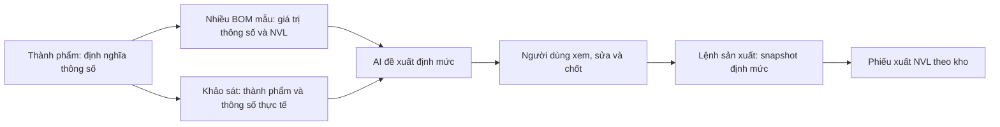

# Khảo sát hiện trạng và kế hoạch BOM thành phẩm theo thông số

Ngày: 12/10/2026. Nền code: `origin/developer`, commit `463a186`.

**Cập nhật sau triển khai:** luồng BOM mẫu → khảo sát thành phẩm → đề xuất NVL → xác nhận → lệnh sản xuất/phiếu cấp NVL đã được thực hiện. Migration `027_parameterized_product_boms.sql` đã áp dụng vào CSDL cấu hình trong workspace. Xem phạm vi thực tế, cách dùng, kiểm thử và các phần còn giữ để tương thích trong [báo cáo triển khai](TRIEN_KHAI_BOM_THANH_PHAM_2026-10-12.md). Các mục “hiện trạng” bên dưới mô tả thời điểm khảo sát trước thay đổi.

## 1. Nhu cầu cần đáp ứng

Mỗi thành phẩm được khai báo bộ thông số kỹ thuật khi tạo/sửa vật tư. Đây là **định nghĩa thông số**, gồm tên, kiểu dữ liệu, đơn vị và điều kiện nhập; giá trị của chúng được nhập ở từng BOM mẫu và từng hạng mục khảo sát.

Một thành phẩm có nhiều BOM mẫu. Mỗi mẫu ghi bộ giá trị thông số và định mức NVL thực tế cho một đơn vị thành phẩm. Khi đơn hàng có thông số khác mẫu, hệ thống dùng các mẫu đã xác nhận để AI đề xuất định mức phù hợp. Người dùng xem, sửa và chốt đề xuất trước khi chuyển sang sản xuất và cấp vật tư.

Ví dụ minh họa, không phải số liệu định mức để đưa vào hệ thống:

| Nơi nhập | Thành phẩm Khung | Dữ liệu |
|---|---|---|
| Tạo/sửa vật tư | Định nghĩa thông số | Ngang: số/m; cao: số/m; bước nan: số/cm; quy cách khung: lựa chọn |
| BOM mẫu K01 | Giá trị mẫu | Ngang 4; cao 1; bước nan 40; quy cách khung A; các dòng NVL và lượng đã xác nhận |
| BOM mẫu K02 | Giá trị mẫu khác | Ngang 6; cao 2; bước nan 30; quy cách khung B; định mức khác K01 |
| Khảo sát | Giá trị cần thi công | Ngang 5,2; cao 1,6; bước nan 35; quy cách khung A; số bộ cần làm |
| Đề xuất NVL trong dự án | Kết quả dự thảo | AI nhận K01, K02 và khảo sát; trả danh sách NVL, lượng, cách suy ra và các giả định |
| Người dùng chốt | Phiên bản thi công | Người dùng hiệu chỉnh; lưu bản định mức làm nguồn cho lệnh sản xuất và phiếu kho |

Thông số có thể là a/b/c bất kỳ, không giới hạn ở W/H. Quy cách vật liệu, số mặt, kiểu liên kết hoặc cấu tạo có thể làm thay đổi danh sách NVL, không chỉ thay đổi số lượng.

## 2. Hiện trạng đã kiểm tra

Khảo sát dựa trên code, lịch sử Git, migration và các màn hình local. Các phần quan trọng:

| Khu vực | Đang có | Khoảng cách so với nhu cầu |
|---|---|---|
| `/vat-tu`, `ItemModal` | Phân loại thành phẩm/NVL/dịch vụ; thông số lưu kiểu tên–giá trị trong `items.specification` | Chưa tách thuộc tính cố định khỏi định nghĩa thông số biến đổi; chưa có kiểu, đơn vị, phiên bản cho schema thành phẩm |
| `/vat-tu?tab=bom`, `BomTab` | Một mảng `specification.bom` cho mỗi thành phẩm; dòng NVL, lượng, ghi chú | Chỉ một BOM; chưa có thư viện nhiều bộ giá trị thông số |
| Phương thức 2 trong `BomTab` | Tính theo diện tích, chu vi, nan sắt, LED, nguồn, keo | Công thức và hệ số viết sẵn, đoán nhóm bằng tên/mã; chưa dựa trên nhiều BOM mẫu |
| `product_templates` | Schema tham số, các dòng công thức, một số mẫu kỹ thuật có sẵn | Là mô hình mẫu kỹ thuật cũ; chưa là thư viện BOM mẫu thuộc thành phẩm |
| `ProductTemplateService` sau commit `60f3324` | Ghép thành phẩm trong `items` vào danh sách mẫu; đọc `specification.bom` | Dùng lẫn ID item và ID template; phía server còn tính lượng cố định |
| `/khao-sat`, khảo sát trong dự án | Nhiều hạng mục, kích thước, tham số theo template; component `SurveyItemsManager` có render tham số động | Thành phẩm mới trả `parameterSchema: []`; giao diện vẫn dựa nhiều vào preset khung/mặt/chữ/đèn/nguồn |
| Bóc tách trong `/du-an/[id]` | Chọn hạng mục, sửa dòng BOM, lưu và tạo phiếu xuất kho | Tính bằng calculator hoặc ánh xạ BOM; chưa có bước AI lấy nhiều mẫu, trình bày bằng chứng rồi chốt |
| `/dinh-muc-bom` | Bàn tính biển hiệu riêng, thư viện BOM dự án | Trùng chức năng bóc tách trong dự án; dữ liệu chuẩn, mã SKU và giá viết sẵn |
| `/san-xuat` | Danh sách lệnh, lập lệnh nhiều hạng mục, mở sửa BOM hiện có bằng `bomId` | Nút tạo BOM/đại diện đã gỡ, nhưng modal/state/tab cũ còn sót; đã dọn trong đợt này |
| Lệnh sản xuất | Đọc BOM đã gán, triển khai NVL, snapshot, sản lượng, công đoạn, QC, phiếu kho | Đây là phần tiếp tục dùng; cần nối với đề xuất NVL đã chốt và thông số của đúng hạng mục |

Các nguồn code chính:

- `src/components/vat-tu/ItemModal.tsx`: thông số tên–giá trị, giữ riêng khóa `bom` khi sửa.
- `src/components/vat-tu/BomTab.tsx`: một BOM trong JSON; `calculateParametricQty`, `detectDefaultCalcMode` và lưu mảng dòng.
- `src/services/product-template.service.ts`: ghép hai loại nguồn vào cùng DTO; đọc item dự phòng và công thức lượng cố định.
- `src/components/survey/SurveyItemsManager.tsx`: bộ chọn template, preset và tham số động.
- `src/services/signage-phase2.service.ts`: tạo/sửa khảo sát và các hạng mục.
- `src/app/(dashboard)/du-an/[id]/page.tsx`: nạp BOM khảo sát, bóc tách, lưu BOM và tạo phiếu kho.
- `src/services/signage-phase3.service.ts`: lưu BOM dự án và đồng bộ dòng vật tư.
- `src/services/production-bom.service.ts`, `src/lib/production/bom.ts`: BOM gán vật tư, triển khai thành phẩm nhiều cấp, quy đổi đơn vị.
- `src/services/production.service.ts`, `src/components/production/OrderDraft.tsx`: chốt nguồn, nhân theo sản lượng và tạo phiếu NVL khi gửi duyệt.

## 3. Những phần chồng chéo và lỗi cần giải quyết

1. **ID thành phẩm dùng thay ID template.** `site_survey_items.template_id` tham chiếu `product_templates`, nhưng dropdown mới trả ID từ `items`. Đã tái hiện lỗi SQL `23503`. Cần trường liên kết thành phẩm riêng, không tháo khóa ngoại để hợp thức hóa việc trộn ID.
2. **Một khảo sát có nhiều hạng mục nhưng tìm BOM theo cả khảo sát.** `savedBomForSurvey` và đường PUT mới có thể chọn BOM của hạng mục khác. Lưu/nạp phải theo tổ chức, dự án, khảo sát, hạng mục và phiên bản.
3. **Client/server tính khác nhau.** Phép kiểm tra cùng một dòng Alu `calcMode=area`, kích thước 6×2 m cho client 13,2 m², server 1 m². Chỉ dùng một service tính/kiểm tra kết quả ở server; client hiển thị dữ liệu trả về.
4. **Đổi W/H/số bộ không cập nhật lượng đã ánh xạ.** `customBomItems` giữ kết quả lần chọn thành phẩm. Sửa đầu vào phải đánh dấu đề xuất cũ không còn phù hợp và yêu cầu tính lại.
5. **Sửa khảo sát bằng xóa rồi chèn lại hạng mục.** `updateSiteSurvey` làm thay đổi ID và có thể vướng liên kết BOM. Chuyển sang cập nhật theo ID; xử lý hạng mục bị bỏ riêng, có kiểm tra nguồn đang dùng.
6. **Định mức được hiểu theo hai cơ sở khác nhau.** Một số nơi nhân trước theo số bộ khảo sát, trong khi `OrderDraft` lại nhân theo `targetQty / bomYieldQty`. Chuẩn hóa định mức cho 1 đơn vị thành phẩm; lượng tổng chỉ nhân một lần. Dữ liệu cũ cần lưu rõ cơ sở tính trước khi chuyển.
7. **Nhiều bộ tính và preset.** `signage-bom-calculator`, `calculateParametricQty`, công thức `product_templates` và quy tắc đại diện không thống nhất. Trên giao diện local, một dòng Alu đơn vị Mét hiển thị lượng 13,2 với công thức W×H m² + hao hụt: công thức chưa xử lý quy đổi diện tích sang mét theo khổ vật liệu. Luồng mới lấy BOM mẫu đã xác nhận làm nguồn và kiểm tra đơn vị; bộ tính cũ là luồng tương thích trong thời gian chuyển đổi.
8. **Danh mục bị cắt ở 500 item.** `BomTab` và trang dự án tải `limit=500`; cần tìm kiếm/phân trang phía server, tra cứu theo ID khi nạp mẫu, tránh mất NVL hoặc giá do không nằm trong trang dữ liệu đầu.
9. **API xuất kho dự án tự tìm alias/tên và tạo item khi không tìm được.** Cần liên kết dòng đề xuất với `itemId`/`unitId` thật. Tạo mã NVL mới là thao tác riêng; không để kết quả AI làm sinh mã hàng ngoài ý muốn.
10. **Nhánh lấy item trong `ProductTemplateService` thiếu bộ lọc tổ chức.** Luồng mới phải dùng context người dùng hiện tại, kiểm tra phạm vi dự án và kho ở server; không suy ra tổ chức bằng bản ghi đầu tiên.
11. **Tài liệu và test trình duyệt còn luồng tab cũ.** `docs/PRODUCTION_WORKFLOW.md` và `tests/e2e/test_production_workflow.cjs` vẫn mô tả/bấm “BOM dự án”, “Gán vật tư đại diện” ở màn sản xuất. Phải cập nhật cùng từng bước chuyển đổi.
12. **Maket hiện là điều kiện bắt buộc của sản xuất.** `ProductionBomService.detail` và `ProductionService.submit` kiểm tra maket/khảo sát. Định hướng mới phải nối đúng maket đã duyệt vào đề xuất nếu dự án yêu cầu thiết kế; việc cho sản xuất chỉ từ khảo sát cần được quy định rõ theo loại sản phẩm. Không âm thầm bỏ gate trong lần dọn UI này.

## 4. Phần đã sửa ngay trong lần khảo sát

- Xóa modal tạo BOM từ maket, modal thêm quy cách đại diện, state và import không dùng ở trang danh sách sản xuất.
- Xóa điều kiện hiển thị theo tab cũ: URL `/san-xuat?tab=bom` hoặc `tab=boms` vẫn hiển thị danh sách lệnh, không làm phần nội dung trống.
- Giữ đường mở BOM hiện có bằng `bomId` và form lập lệnh; giữ BOM/snapshot của lệnh sản xuất.
- Link “BOM Dự Án” ở màn maket chuyển về tab bóc tách/xuất kho của dự án. Link mở BOM đã có không phát sinh `tab=bom` nữa.
- API và bảng đại diện còn phục vụ các BOM hiện tại. Việc bỏ vai trò đại diện khỏi luồng mới nằm ở bước chuyển đổi dữ liệu và service, không xóa dữ liệu đang được tham chiếu.

## 5. Mô hình đích

Ba loại dữ liệu có mục đích khác nhau:

- **Thành phẩm:** mã hàng chung và định nghĩa thông số, dùng ở nhiều đơn hàng.
- **BOM mẫu:** bộ giá trị thông số và NVL đã được người dùng xác nhận, là dữ liệu tham chiếu có phiên bản.
- **Đề xuất NVL dự án:** định mức cho thông số khảo sát cụ thể, có kết quả AI và sửa của người dùng, được chốt thành nguồn sản xuất.

### 5.1. Dữ liệu đề xuất

Tên bảng/cột dưới đây là thiết kế dự kiến, chưa được tạo:

| Đối tượng | Dữ liệu chính | Quy tắc |
|---|---|---|
| `product_parameter_schemas` | `organization_id`, `product_item_id`, version, definitions | Mỗi định nghĩa có key ổn định, tên, type, đơn vị, required, khoảng giá trị/lựa chọn; không lưu giá trị khảo sát ở đây |
| `product_bom_samples` | Thành phẩm, schema version, mã, tên, `parameter_values`, `yield_qty`, status, revision | Nhiều mẫu/thành phẩm; chuẩn cho 1 đơn vị cơ sở; bản đã xác nhận có phiên bản, không sửa ngầm |
| `product_bom_sample_lines` | Sample ID, NVL ID, unit ID, quantity, hao hụt, ghi chú | Dùng mã hàng/đơn vị thật; dịch vụ tách thành dòng chi phí, không xuất kho như NVL |
| `site_survey_items` bổ sung | `product_item_id`, schema version, `parameter_values` | Giữ `template_id` cho dữ liệu cũ; không gán item vào template; giữ ID hạng mục khi sửa |
| `material_proposals` | Dự án, khảo sát, hạng mục, thành phẩm, input snapshot/hash, status, revision | Mỗi hạng mục có đề xuất riêng; draft → confirmed → superseded; đầu vào đổi làm draft cũ cần tính lại |
| `material_proposal_lines` | NVL/unit ID, lượng cho 1 sản phẩm, lượng tổng, AI reasoning, chỉnh sửa người dùng | Nguồn gốc và kết quả sửa được lưu; có validation và quy đổi đơn vị |
| `material_proposal_runs` | Mẫu/revision dùng làm nguồn, provider/model, prompt version, kết quả và lỗi | Lưu đủ dữ liệu giải thích/tái hiện; retry không làm trùng đề xuất hoặc chứng từ |
| BOM/lệnh sản xuất hiện có | Proposal/revision ID và snapshot đã chốt | Chốt nguồn trước gửi duyệt; sửa mẫu hay khảo sát không làm thay đổi lệnh/phiếu đã chốt |

Không biến toàn bộ `items.specification` thành chỗ chứa schema, danh sách mẫu và lịch sử AI. Thông số vật liệu cố định hiện tại vẫn là thuộc tính vật tư; định nghĩa biến đổi và các BOM mẫu có nơi lưu riêng để truy vấn, phân quyền và quản lý phiên bản.

### 5.2. Giao diện dự kiến

**Vật tư → tạo/sửa thành phẩm:** có phần “Thông số cần nhập khi lập BOM/khảo sát”. Thêm/sửa trường a, b, c; chọn loại dữ liệu và đơn vị. Không ép nhập giá trị mẫu ngay ở form thành phẩm.

**Vật tư → BOM thành phẩm:** chọn thành phẩm; thấy danh sách BOM mẫu. Mỗi mẫu có bộ giá trị thông số và bảng NVL. Có tạo, nhân bản, sửa nháp, xác nhận, xem phiên bản và ngừng sử dụng. Màn W×H/đoán công thức hiện tại được thay bằng dữ liệu mẫu này.

**Khảo sát:** mỗi hạng mục chọn thành phẩm và nhập form sinh từ schema của nó; số bộ là trường riêng. Đổi thành phẩm phải kiểm tra lại thông số. Hai điểm tạo/sửa khảo sát (trang khảo sát và modal dự án) dùng chung component, DTO và validator.

**Dự án → đề xuất NVL:** chọn hạng mục khảo sát; xem thông số; bấm “AI đề xuất NVL”. Màn kết quả cho thấy mẫu được dùng, NVL, đơn vị, lượng cho 1 sản phẩm, số bộ và lượng tổng, cách suy ra, giả định hoặc dữ liệu thiếu. Người dùng sửa, thêm/xóa NVL rồi chốt.

**Sản xuất:** nhận những đề xuất đã chốt, có thành phẩm, thông số và NVL đúng hạng mục. BOM trong lệnh là bản lưu tại thời điểm chốt. Không dựng lại từ BOM mẫu mới mỗi lần mở lệnh.

**Phiếu xuất kho:** tiếp tục dùng cơ chế phiếu chờ duyệt theo kho của lệnh sản xuất. Luồng xuất trực tiếp từ dự án cần chuyển sang dùng cùng đề xuất đã chốt và cùng sổ cấp NVL để không cấp hai lần cho một nhu cầu. Có thể chỉ cho tạo phiếu từ lệnh ở giai đoạn đầu để tránh hai luồng cấp phát song song.

### 5.3. Cách dùng AI

1. Server lấy schema, giá trị khảo sát, các BOM mẫu đã xác nhận của đúng thành phẩm/tổ chức và danh mục NVL/đơn vị được phép dùng.
2. Ưu tiên mẫu cùng cấu tạo/quy cách; chỉ khác kích thước mới xem xét suy ra lượng. Không coi khung khác cấu tạo hoặc vật liệu khác là các điểm nội suy tương đương.
3. Nếu trùng thông số với mẫu đã xác nhận, có thể dùng lại mẫu trực tiếp và ghi rõ nguồn. Nếu khác, AI nhận nhiều mẫu thích hợp để đưa đề xuất và giải thích từng dòng. Không huấn luyện mô hình riêng ở giai đoạn đầu.
4. Output có cấu trúc: item ID, unit ID, quantity per unit, mẫu nguồn, cách tính, giả định và cảnh báo. AI chỉ đưa dự thảo; server kiểm tra ID, phạm vi dữ liệu, số hữu hạn, lượng, đơn vị, quy đổi và tổng.
5. Phần nhân số bộ, hao hụt, quy đổi đơn vị và làm tròn do server xử lý thống nhất. Quy tắc làm tròn theo quy cách mua/xuất được khai báo rõ, không mặc định mọi dòng đều làm tròn giống nhau.
6. Không có mẫu phù hợp, thiếu thông số hoặc khác cấu tạo thì hiển thị dữ liệu thiếu/ngoại suy cần kiểm tra; người dùng có thể nhập tay. Lỗi AI giữ nguyên nháp đang sửa, không tự tạo lệnh hoặc phiếu kho.
7. Sửa thông số khảo sát, thay mẫu nguồn hoặc thay số bộ cần có so sánh với đầu vào đã tính. Kết quả đã chốt chỉ thay qua phiên bản mới. BOM mẫu đã chốt phiên bản cũ vẫn phải đọc được.

AI tính định mức NVL dựa trên mẫu đã xác nhận; việc xác nhận kết cấu/kỹ thuật thuộc người phụ trách. Đối với những thông số cần quy tắc kỹ thuật cụ thể, lưu quy tắc cùng mẫu để AI giải thích và server kiểm tra được.

## 6. Kế hoạch thực hiện và điều kiện hoàn thành

| Bước | Phạm vi | Điều kiện hoàn thành |
|---|---|---|
| 0 — Dọn màn sản xuất | Modal/state/tab cũ, các link vào màn đã bỏ | Không còn đường tạo BOM/đại diện riêng tại danh sách sản xuất; lệnh và BOM hiện có vẫn mở được. Đã sửa code trong đợt khảo sát |
| 1 — Thành phẩm và BOM mẫu | Migration cộng thêm; schema thông số; CRUD BOM mẫu; thay `BomTab`; form vật tư dùng chung | Một thành phẩm tạo được K01/K02 có a/b/c và NVL khác nhau; sửa/ngừng mẫu không đổi bản đã được dùng |
| 2 — Khảo sát theo thành phẩm | `product_item_id`, giá trị thông số, validator chung; giữ ID khi sửa | Chọn thành phẩm, nhập a/b/c, lưu/mở lại đúng; hai hạng mục khác nhau không dùng nhầm định mức |
| 3 — AI đề xuất trong dự án | Retrieval mẫu, output cấu trúc, kiểm tra server, bảng xem/sửa/chốt, lịch sử | AI dùng đúng các mẫu và thông số; nhập thiếu/đổi đầu vào/AI lỗi có hành vi rõ; người dùng chốt trước tạo lệnh |
| 4 — Nối sản xuất và kho | Adapter vào BOM hiện có, snapshot, sản lượng, kho, idempotency | Một bộ định mức chỉ nhân số bộ một lần; tạo/duyệt lệnh cấp đúng NVL; retry và luồng dự án không tạo phiếu trùng |
| 5 — Chuyển dữ liệu và bỏ luồng trùng | BOM JSON cũ, template cũ, đại diện, calculator độc lập, tài liệu/test | Dữ liệu cũ mở được; không còn nút/route tính định mức cạnh tranh ở luồng mới; chứng từ đã chốt không đổi |

### Chuyển dữ liệu cũ

- Mỗi `items.specification.bom` cũ có thể thành một BOM mẫu legacy. Nếu không biết kích thước/cấu tạo gốc, đánh dấu “Chưa có thông số tham chiếu”; không tự điền 6×2 m rồi coi là mẫu để AI suy ra.
- Mẫu `product_templates` cũ được gắn thành phẩm qua mapping rõ ràng. Mẫu chưa có mapping vẫn đọc được trong luồng cũ; không tự ghép theo tên gần giống.
- BOM dự án và lệnh đã chốt giữ snapshot; dòng đại diện cũ tiếp tục có adapter đọc/ghi trong thời gian chuyển đổi.
- Xác minh định mức cũ theo 1 sản phẩm hay toàn bộ hạng mục trước khi đặt `yield_qty`; không chia/nhân tự động nếu không có nguồn chứng minh.
- Migration cộng thêm bảng/cột, có kiểm tra dữ liệu và báo cáo trước khi chuyển. Không cập nhật số dư kho hay sửa phiếu đã ghi sổ.

### Các kiểm thử cần bổ sung cho lần triển khai mô hình mới

- CRUD schema: số, lựa chọn, boolean, text; đơn vị; required; thay schema nhưng vẫn đọc được bản cũ.
- Một thành phẩm có nhiều BOM mẫu; nhân bản và phiên bản; số lượng/unit ID/hao hụt hợp lệ.
- Tạo/sửa khảo sát từ cả hai màn; giữ ID; ID item không lọt vào FK template.
- Khảo sát có hai hạng mục; lưu/chốt cả hai rồi mở lại không ghi đè.
- Thông số trùng mẫu; khác kích thước; khác cấu tạo; thiếu mẫu; số bộ >1; đổi đầu vào sau AI.
- AI trả NVL ngoài tổ chức, mã không có, số âm/NaN, đơn vị sai, output thiếu, timeout: không chốt/chuyển tiếp.
- Sửa tay sau AI được lưu; định mức đã chốt không đổi khi sửa mẫu hoặc khảo sát.
- Hai luồng tạo/cấp NVL, bấm lặp, gửi lại request và chạy đồng thời không tạo trùng phiếu.
- Tiếp tục chạy test kho/production về giữ hàng, cấp bổ sung, trả dư, QC, nhập thành phẩm, quy đổi và khóa phiên bản.
- E2E cập nhật theo màn mới; test dùng database cô lập. Các lần khảo sát UI local trong đợt này chỉ đọc và chặn request ghi.

## 7. Phạm vi và thứ tự khuyến nghị

Triển khai **Bước 1 → 2 → 3 → 4**, sau đó bỏ các luồng cũ theo Bước 5. Không bắt đầu bằng thay prompt AI trên dữ liệu BOM hiện có, vì còn thiếu thư viện mẫu, schema thành phẩm, định danh hạng mục và cơ sở tính sản lượng.

Trong đợt khảo sát này, chỉ phần dọn UI sản xuất và các link liên quan đã được sửa. Mô hình dữ liệu, AI và migration nêu trên là kế hoạch thực hiện tiếp, chưa được triển khai. Việc kiểm tra hiện trạng không tạo/sửa dữ liệu nghiệp vụ trong database ứng dụng.

## 8. Kiểm chứng lần khảo sát

- `npm run typecheck`: pass sau các thay đổi code.
- `git diff --check`: không có lỗi whitespace trong phần sửa.
- Browser local `/san-xuat?tab=bom`: danh sách lệnh hiển thị, không có nút tạo BOM/đại diện riêng; mở form lập lệnh vẫn chọn được BOM hiện có.
- Browser local `/vat-tu?tab=bom`: thấy một bảng định mức theo thành phẩm và Phương thức 2 W×H, chưa có danh sách nhiều mẫu thông số.
- Browser local `/khao-sat`: mở được form thêm khảo sát; vẫn là mẫu kỹ thuật và các nhóm quy cách khung/mặt/đèn/nguồn.
- Browser local `/dinh-muc-bom`: vẫn có bàn tính độc lập với preset, cấu hình và thư viện BOM dự án.
- Không có `pageerror` trong phiên kiểm tra trình duyệt đã hoàn tất. Request API ghi bị chặn, không bấm lưu khảo sát hay lưu lệnh.
- Ảnh local trong thư mục Git bỏ qua `scratch/bom-audit/`: `san-xuat.png`, `vat-tu.png`, `survey-form.png`, `dinh-muc-bom.png`.
- Bộ test nền ở lượt review trước thay đổi UI: 216/216 pass. Test E2E production cũ chưa phù hợp màn hiện tại, không coi kết quả bộ test nền là bằng chứng đã đáp ứng mô hình BOM mới.
