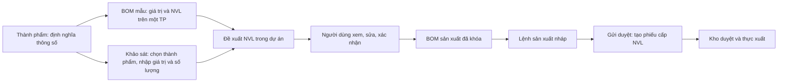

# BOM thành phẩm theo thông số — kết quả triển khai

Ngày 12/10/2026. Nền `origin/developer` tại `463a186`. Bản triển khai trên nhánh `developer`; báo cáo này đi cùng mã nguồn và migration. Chưa deploy lên hosting.

## Luồng đã có

1. **Vật tư → tạo/sửa mặt hàng → Thành phẩm:** khai báo mã thông số, tên, kiểu số/văn bản/có-không, đơn vị, bắt buộc và giới hạn số. Không nhập giá trị mẫu ở bước này. Thay đổi định nghĩa tạo phiên bản mới, giữ phiên bản đã dùng.
2. **Vật tư → BOM mẫu thành phẩm:** chọn thành phẩm; nhập giá trị của thông số; chọn NVL/dịch vụ và đơn vị hợp lệ; nhập lượng trước hao hụt và tỷ lệ hao hụt. Định mức tính cho **một đơn vị cơ sở** của thành phẩm. Có thể lưu nháp hoặc xác nhận mẫu. Mẫu đã xác nhận chỉ được xem, sao chép hoặc ngừng sử dụng. Bản sao dùng bộ thông số mới nhất; nếu phiên bản đổi thì phải nhập lại giá trị, tránh giữ nhầm giá trị khi đơn vị đổi.
3. **Khảo sát:** chọn thành phẩm thật từ danh mục, nhập thông số và số lượng thực tế. Không tự gắn mẫu biển Alu hay công thức WxH cho hạng mục mới. Sửa khảo sát giữ ID hạng mục; chỉ xóa những hạng mục bị bỏ khỏi danh sách.
4. **Dự án → Bóc tách & Xuất kho → Đề xuất NVL theo thông số khảo sát:** chọn hạng mục để lập đề xuất. Thông số trùng mẫu đã xác nhận thì dùng định mức mẫu trực tiếp. Thông số khác thì AI nhận tối đa 12 mẫu gần nhất của cùng thành phẩm, cùng phiên bản thông số. Người dùng xem mẫu tham chiếu, cách suy luận, cảnh báo, chỉnh lượng/hao hụt/vật tư và xác nhận.
5. **Lập lệnh sản xuất:** thành phẩm, đơn vị, số lượng lấy từ đề xuất đã xác nhận; BOM tương ứng một thành phẩm. Người dùng chọn tổ và kho. Gửi duyệt lệnh mới tạo phiếu cấp NVL. Kho duyệt và thực xuất theo quy trình hiện có; thiếu tồn vẫn phải xử lý trước khi thực xuất.

AI không tạo mã vật tư mới và không thay thế bước rà soát của người dùng. Mọi kết quả đều qua kiểm tra NVL, đơn vị, lượng hữu hạn/dương và hao hụt ở server. Dịch vụ được giữ trong đề xuất, không đưa vào yêu cầu xuất kho.

## Dữ liệu và bảo vệ

- Migration `027_parameterized_product_boms.sql` bổ sung `product_parameter_schemas`, `product_bom_samples`, `material_proposals` và liên kết thành phẩm/thông số trên `site_survey_items`. Dòng định mức được lưu dưới dạng JSON đã kiểm tra; không tạo thêm bảng dòng mẫu/đề xuất như thiết kế ban đầu. Khi xác nhận, NVL được chuyển sang `project_bom_lines` để dùng hệ thống sản xuất/kho hiện có.
- Migration đã chạy thử và rollback, sau đó áp dụng thành công vào CSDL cấu hình trong workspace. Có 4 BOM JSON cũ được giữ nguyên thành mẫu nháp cần rà soát. Tại thời điểm áp dụng, chưa có bộ thông số cho 6 thành phẩm đang hoạt động; người dùng cần khai báo các thông số thực tế và xác nhận mẫu trước khi tính đề xuất.
- Giữ phiên bản thông số, giá trị khảo sát, số lượng, các mẫu tham chiếu, kết quả AI và dòng đã duyệt. BOM/lệnh giữ snapshot để lịch sử không đổi theo khảo sát hay mẫu về sau.
- Kiểm tra lại nguồn khảo sát khi kết thúc tính AI, khi xác nhận, khi tạo/sửa lệnh nháp và khi gửi duyệt. Nếu số đo, số lượng, sản phẩm hoặc quy đổi đơn vị đã đổi thì phải lập đề xuất mới.
- API kiểm tra tổ chức, quyền và phạm vi dự án. Danh mục thành phẩm khảo sát được đọc qua quyền khảo sát; không cấp quyền sửa BOM cho người chỉ xem khảo sát. Các bảng mới có chính sách cô lập tổ chức.
- Request UUID hỗ trợ gửi lại mà không tạo bản ghi trùng. Phiên bản ngăn hai người ghi đè cùng bản nháp. Cùng hạng mục khảo sát chỉ được có một lệnh chưa hủy trong luồng mới. Khi có lệnh, giao diện dẫn tới lệnh hiện có.
- Trigger bảo vệ bộ thông số, mẫu đã xác nhận, đề xuất đã xác nhận, BOM và dòng BOM khỏi sửa qua luồng cũ. Xóa khảo sát gỡ liên kết nhưng giữ snapshot của đề xuất/lệnh.
- Luồng mới xuất phát từ khảo sát không bắt buộc maket. Luồng sản xuất từ maket cũ vẫn yêu cầu maket đã duyệt.

## Những phần đã dọn

- Bỏ state/modal tạo BOM độc lập và tạo đại diện ở màn Sản xuất; giữ xem BOM trong quy trình lệnh.
- Bỏ tab BOM cũ khiến `/san-xuat?tab=bom` trống; sửa các link cũ.
- Thay màn BOM JSON đơn lẻ của vật tư bằng BOM mẫu theo thông số.
- Bỏ nhánh coi thành phẩm là `product_template` giả và tự co giãn theo diện tích/chu vi với hệ số mặc định.
- Thay form khảo sát tự gắn preset và quy cách mặc định bằng form thông số thành phẩm.
- `/dinh-muc-bom` chuyển tới `/vat-tu?tab=bom`, tránh thêm một nơi tạo định mức riêng.
- Khảo sát thành phẩm đi tới đề xuất của dự án thay vì mở bộ tính WxH cũ. BOM thuộc đề xuất mới không được đưa vào danh sách chỉnh sửa BOM cũ của dự án.

Các mẫu công thức biển cũ, báo cáo, tính báo giá cũ, bảng đại diện nội bộ và API BOM cũ vẫn được giữ cho dữ liệu/quy trình cũ. Chưa chuyển tự động các khảo sát cũ sang thành phẩm vì chưa đủ căn cứ để gán sản phẩm, thông số và đơn vị. Không thay đổi tồn kho hay lệnh đang chạy trong quá trình triển khai.

## Kiểm chứng

- `npm run check`: TypeScript đạt; **220/220 kiểm thử đạt**, không có bài lỗi hoặc bỏ qua.
- `npm run build`: build production thành công, dùng thư mục `.next-production-verification` riêng.
- `tests/parameterized-product-bom.test.cjs`: kiểm tra kiểu/giới hạn thông số; mẫu có phiên bản; ID khảo sát giữ nguyên; quyền/phạm vi; HTTP form lưu định nghĩa cùng sản phẩm và rollback khi sai; kết quả AI giả lập sai bị chặn; nguồn khảo sát đổi; snapshot bất biến; lệnh/phiếu không trùng; dịch vụ không xuất kho; quy đổi đổi sau xác nhận bị chặn.
- Bài tính: `7 × 3 × 1,10 = 23,1` và `1 cây × 6 mét/cây × 2 TP × 1,10 = 13,2 mét`. Xác nhận chưa tạo phiếu; gửi duyệt chưa trừ tồn; chỉ thực xuất mới trừ.
- Kiểm tra AI thật với dữ liệu giả qua model đang cấu hình `gemini-3.5-flash-lite`: hai mẫu khung chu vi 6/10 m, mục tiêu 3 × 1 m, số lượng 3 TP; AI trả **8 m trên một TP**, không nhân thành 24 m trong định mức.
- Playwright kiểm tra màn vật tư/BOM mẫu, khảo sát, dự án, sản xuất và redirect; đi qua sửa/xác nhận đề xuất rồi mở lệnh với thành phẩm, số lượng và cơ sở BOM đúng. Không bị thêm trùng hạng mục khi React StrictMode chạy effect lại. Các form dùng API ghi giả lập, API ghi thật bị chặn. Ảnh tại `scratch/bom-audit/`. Không phát hiện lỗi JavaScript trên các màn đã kiểm tra.

`npm run db:verify` **chưa đạt trên toàn CSDL** vì lệch có sẵn trước luồng BOM: 8 migration cũ chưa được ghi nhận trong ledger (`017`, `018`, `021`–`026`), và thiếu 56 cột ở 4 bảng GPS (`fleet_gps_daily_summaries`, `fleet_gps_import_batches`, `fleet_gps_journey_events`, `fleet_gps_summary_audit`). Migration `027` được ghi nhận đúng, không có checksum thay đổi; các bảng/cột của luồng BOM mới khớp. Không tự chạy lại migration seed cũ để tránh ghi đè các mẫu/cấu hình người làm cùng đã sửa.

## Cách bắt đầu với dữ liệu thật

Chọn một thành phẩm cần dùng, khai báo bộ thông số đúng và tạo ít nhất một BOM mẫu đã xác nhận với NVL/đơn vị thật. Tạo khảo sát trong dự án rồi lập đề xuất NVL. Đánh giá chất lượng suy luận AI bằng các mẫu thực tế của xưởng; kiểm tra riêng cấu tạo, gia cố và hao hụt nếu thông số mới nằm ngoài phạm vi mẫu.
